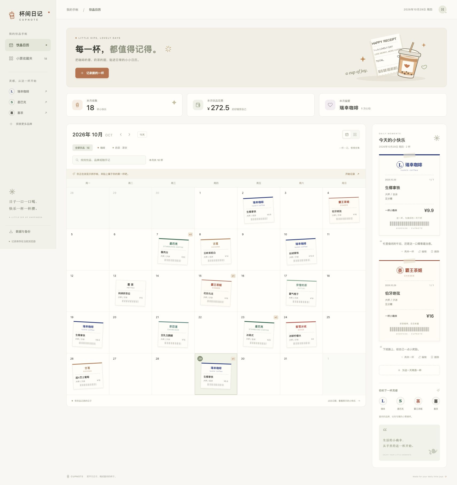

# 杯间日记 · Cupnote

把每天的咖啡与奶茶贴进日历，收藏一杯一杯的小快乐。

[](https://github.com/Habby-me/cupnote/actions/workflows/ci.yml)
[](LICENSE)
[](https://developer.mozilla.org/docs/Web/JavaScript/Guide/Modules)

[更新记录](CHANGELOG.md) · [架构说明](docs/ARCHITECTURE.md) · [参与开发](CONTRIBUTING.md) · [后续计划](docs/ROADMAP.md)



## 可以做什么

- **日历手帐**：月历与小票墙两种展示，同一天多杯显示右上角 `+N`，点击日期可查看全部小票。
- **品牌杯贴**：瑞幸、星巴克、喜茶、霸王茶姬、奈雪、蜜雪冰城、茶百道、古茗、CoCo 九种原创主题。
- **完整记录**：饮品、日期、金额、杯型、温度、甜度和随手记，支持修改、删除及 10 秒内撤销。
- **再来一杯**：从历史小票沿用喜欢的配方，以今天的日期新增一条记录。
- **随手查找**：搜索本月饮品、品牌和随手记，可与咖啡或茶饮筛选组合使用。
- **月度统计**：显示当月全部饮品的杯数、花费和偏好品牌，搜索不会改变统计口径。
- **自己保管**：浏览器自动保存、JSON 备份恢复、CSV 表格导出，并保留损坏数据的恢复入口。

第一次访问显示示例手帐；保存第一杯后切换到个人记录。示例数据不会混进个人备份。

## 本地运行

需要 Node.js 22 或更新版本。

```sh
git clone https://github.com/Habby-me/cupnote.git
cd cupnote
npm ci
npm start
```

打开 <http://localhost:5174>。界面无构建步骤，修改 `dist/` 文件后刷新即可。只想运行页面时可以省略 `npm ci`，运行时没有第三方依赖。

```sh
PORT=8080 npm start  # 端口被占用时换一个
npm run dev         # 修改预览服务器后自动重启
```

## 自动检查

```sh
npm run verify       # JavaScript 语法检查 + 35 项核心测试
npm run test:coverage # Node 内置覆盖率报告
npx playwright install chromium
npm run test:e2e     # 桌面和手机共 14 项浏览器流程测试
```

CI 在 Node.js 22、24 和两个时区验证核心行为，并使用 Chromium 验证桌面、手机流程。浏览器测试使用独立上下文和合成数据，不读取个人记录；失败时保存 trace，方便复现。

核心回归包括闰年和六周月份、金额小数、重复备份、无效导入、存储配额不足、损坏数据保护、CSV 公式文本，以及本地服务器的路径边界。

## 数据放在哪里

所有记录保存在当前浏览器的 `cupnote.journal.v1` 中，没有云端数据库、账户系统、分析脚本或第三方字体请求。不同设备、浏览器配置文件和网站来源分别保存各自的数据；不会自动跨设备同步。

- 更换设备或清理网站数据前，请从「数据与备份」导出 **JSON**；在目标浏览器导入即可。
- **CSV** 适合在表格软件中查看和分析，不能作为恢复文件导入。
- 导入前会校验整个文件，只按记录 ID 去重，同一天两杯相同饮品会被保留。
- 损坏的本地数据不会被普通保存覆盖；可以先导出原始文本，再用有效备份恢复。
- 浏览器配额不足时，新改动可能只保留在本页内存中；请按提示尽快导出备份。
- 同来源多标签页会同步已完成的写入，但没有并发事务或冲突合并。详情见[架构说明](docs/ARCHITECTURE.md)。

## 项目结构

```text
dist/
  index.html              页面与原生对话框
  style.css               手帐和小票视觉样式
  enhancements.css        搜索、撤销与恢复交互样式
  app.js                  DOM 渲染与事件
  lib/
    brands.js             品牌配置
    journal.js            日期、统计、搜索、导入与 CSV 规则
    storage.js            本地持久化和恢复保护
server.mjs                无依赖的本地静态服务器
scripts/check.mjs         全项目 JavaScript 语法检查
tests/                    Node 核心测试和 Playwright 浏览器测试
.github/                  CI、Issue 与 PR 模板
docs/                     架构、预览图和路线图
```

直接将 `dist/` 部署到任意静态托管即可。所有页面资源使用相对地址，支持 GitHub Pages 项目子路径。现有私人站点在[这里](https://cupnote-daily-sips.cbgftqczfq.chatgpt.site)，需要站点拥有者账号访问。

## 贡献与许可

欢迎通过 [Issue](https://github.com/Habby-me/cupnote/issues/new/choose) 描述真实使用中遇到的问题。提交改动前请阅读[贡献指南](CONTRIBUTING.md)。尚未实现的功能单独列在[路线图](docs/ROADMAP.md)中。

[MIT](LICENSE) · Built by [Habby-me](https://github.com/Habby-me)。品牌名称用于个人饮品识别，杯贴为原创主题，不是官方订单凭证；品牌商标的权利属于各自权利人。
